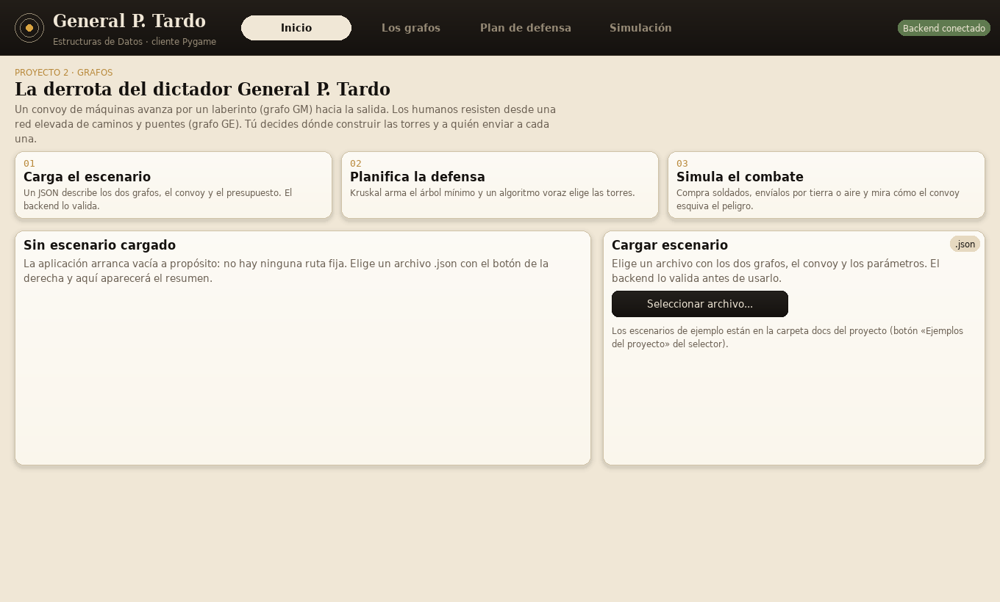
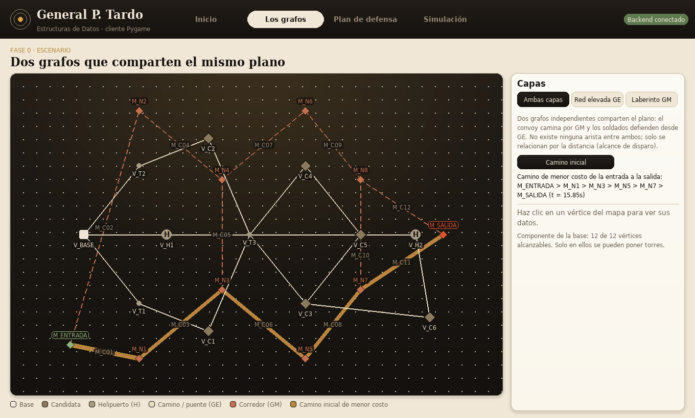
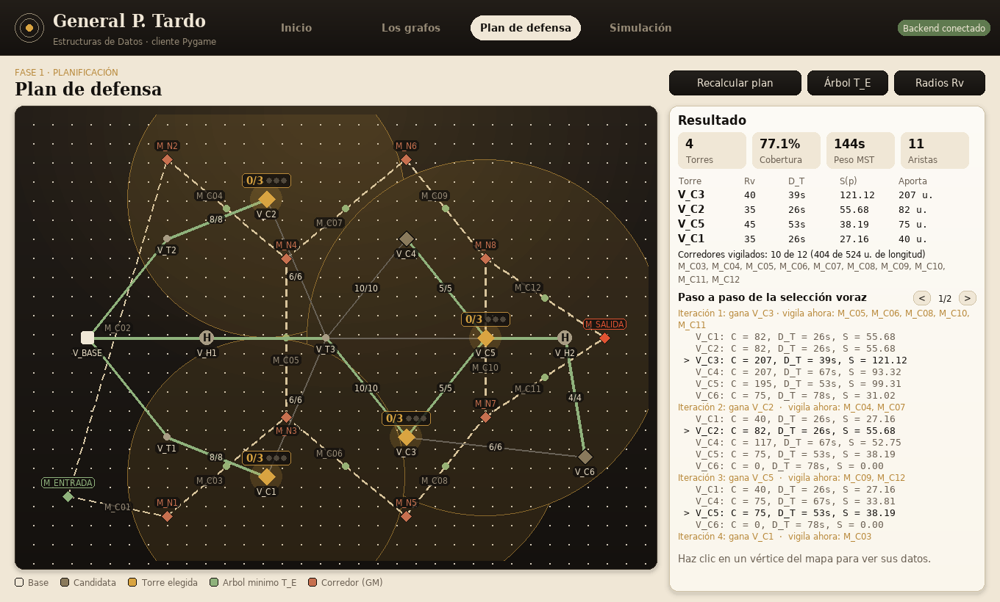
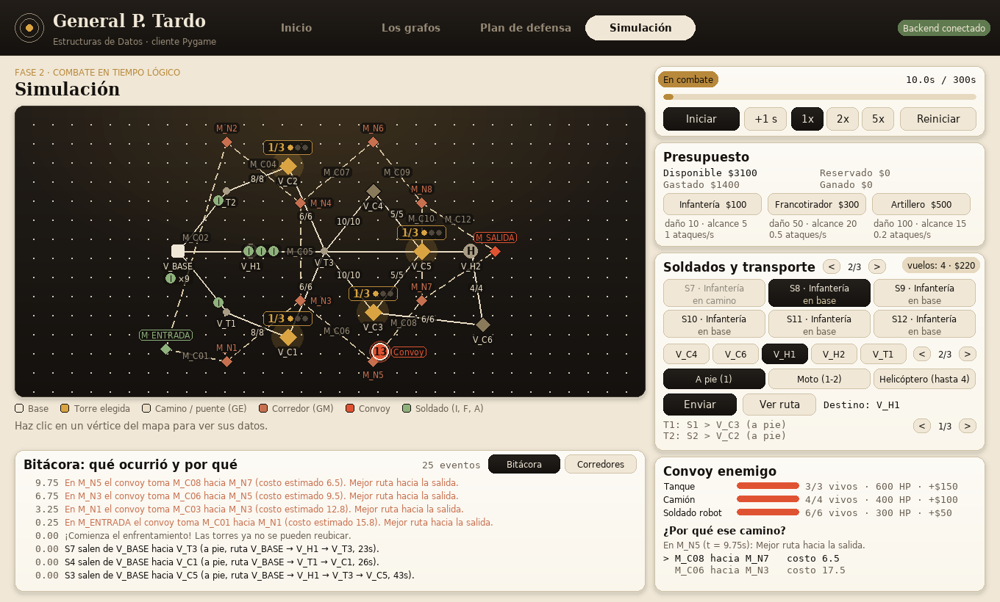
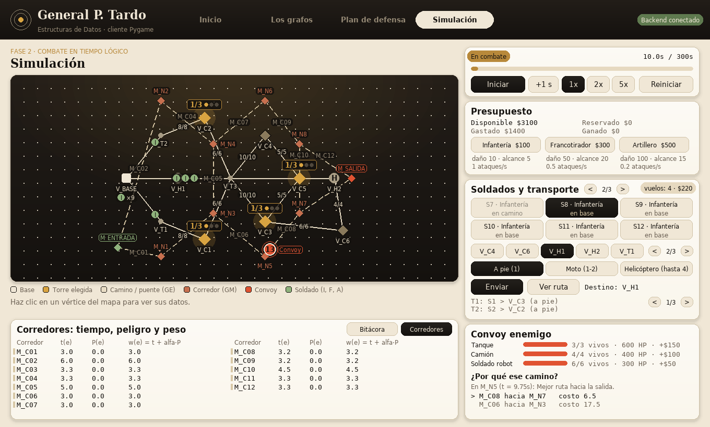
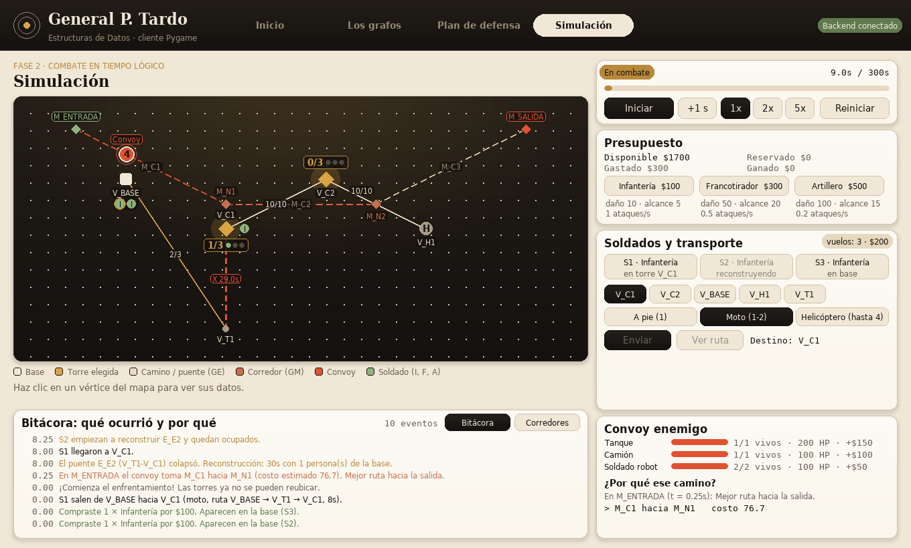
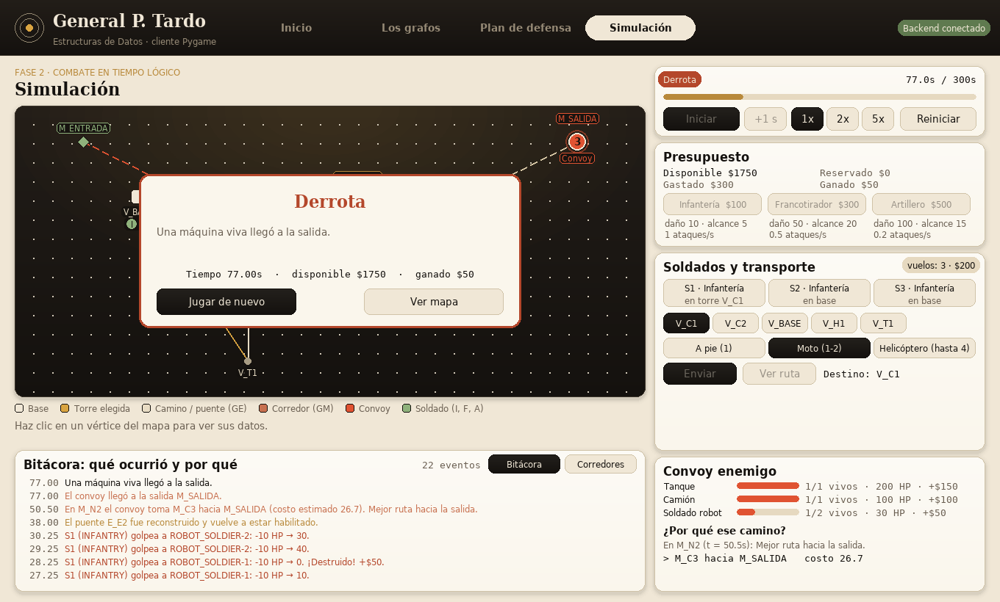
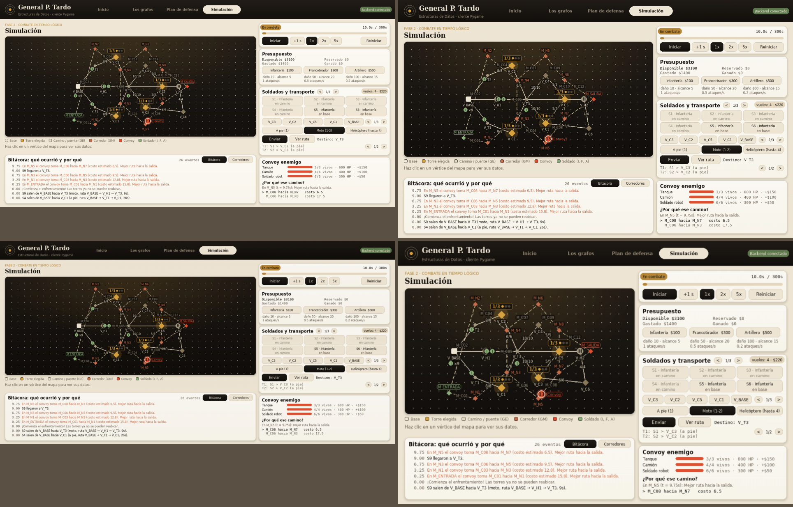
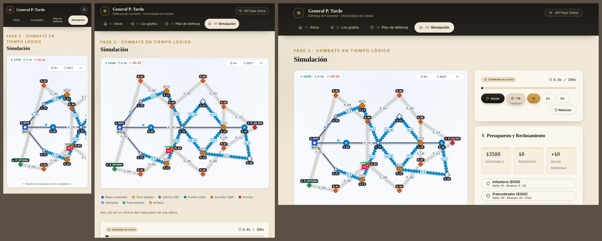

# Informe de estado por requisito — «La derrota del dictador General P. Tardo»

- **Fecha:** 27 de noviembre de 2026
- **Rama revisada:** `prueba` (commit `1ce5dd0` más correcciones sin commit)
- **Referencia:** `ProyectoGrafos.pdf` (secciones 2 a 14)
- **Versión:** tercera revisión, después de las correcciones visuales (responsive y `clamp()`).

## 1. Resultado general

De 85 puntos: **82 cumplen, 1 cumple con observación, 0 fallan y 2 están pendientes.**

| | Primera revisión | Ahora |
|---|---|---|
| ✅ Cumple | 63 | 82 |
| ⚠️ Con observación | 16 | 1 |
| ❌ Falla | 4 | 0 |
| ⏳ Pendiente | 2 | 2 |

Para llegar a 85 de 85 faltan tres cosas que dependen de los integrantes:

1. Grabar el **video de explicación en una segunda lengua** (con todos).
2. Grabar el **videotutorial** del sistema.
3. Llenar los **[completar]** de `reporte_uso_ia.md` (qué revisó cada uno y confirmación).

## 2. Cómo se verificó

Máquina virtual Linux en el computador del equipo, sobre una copia de la rama: Python 3.10.12, pygame 2.6.1,
Flask 3.1.3, pytest 9.2.0, Node 22. La ventana Pygame se dibujó en una pantalla virtual.
La web se recorrió en Chromium sin ventana (Linux), de 320 a 1920 px y con los 6 escenarios, midiendo desborde horizontal,
etiquetas encimadas y tamaño de los botones en celular emulado.
**No se probó en Windows nativo ni en un celular real.** El diálogo de archivos del sistema se probó simulando sus respuestas.

| Prueba | Antes | Ahora |
|---|---|---|
| `backend`: `python -m pytest tests` | 242 de 242 | **284 de 284** |
| `desktop`: `python -m pytest tests` | 85 de 91 | **122 de 122** |
| `backend/verificar.py` | 2 problemas | **Todo correcto** |
| Auditoría contra servidor real | 47 de 47 | **47 de 47** |
| `docs/evidencia_estado/verificar_correcciones.py` | 5 fallos | **5 de 5 corregidos** |
| `frontend`: `npm run build` | Compila | Compila |

Partidas automáticas con una estrategia simple (llenar torres a pie), para comprobar que los 6 escenarios terminan:

| Escenario | Torres / cobertura | Resultado | Tiempo |
|---|---|---|---|
| asedio_final | 2 / 100 % | Derrota | 19,5 s |
| complejo | 2 / 72,2 % | Victoria por eliminación | 22,25 s |
| cuadrilla | 2 / 100 % | Victoria por eliminación | 20,25 s |
| general_p_tardo | 2 / 100 % | Derrota | 23 s |
| gran_ciudadela | 4 / 77,1 % | Derrota | 16,25 s |
| puentes | 2 / 100 % | Victoria por eliminación | 20,25 s |

## 3. Estado por requisito

✅ Cumple · ⚠️ Cumple con observación · ❌ No cumple o falla · ⏳ Pendiente

### §2 Alcance y decisiones de diseño

| Solicitud | Estado | Evidencia u observación |
|---|---|---|
| Dos grafos con estructuras propias | ✅ | Listas de adyacencia en `graph_e.py` y `graph_m.py` |
| Sin NetworkX ni bibliotecas de grafos | ✅ | Kruskal, Union-Find, Dijkstra y montículo propios |
| Entidades y responsabilidades definidas | ✅ | Código y manual técnico §2 |
| Estructuras auxiliares justificadas | ✅ | Manual técnico §6–§8. Los eventos temporales son contadores por entidad, no una cola |
| Separación lógica / algoritmos / interfaz; verificable sin Pygame | ✅ | 284 pruebas de backend sin Pygame |
| Reloj lógico en segundos y unidades consistentes | ✅ | Paso fijo de 0,25 s; los tiempos se redondean hacia arriba a ese paso |

### §3 Representación de los grafos

| Solicitud | Estado | Evidencia u observación |
|---|---|---|
| GE: identificador único e inmutable | ✅ | Unicidad validada; la inmutabilidad es por convención |
| GE: coordenadas finitas y positivas | ✅ | `validator.py` |
| GE: tipos base, candidato, tránsito, helipuerto | ✅ | El helipuerto es punto de aterrizaje y recogida |
| GE: aristas no dirigidas, tiempos positivos a pie y en moto | ✅ | `null` = medio no permitido |
| GE: puentes con resistencia máxima y actual enteras positivas | ✅ | Validado |
| Exactamente una base | ✅ | Validado |
| Puente destruido sale de las búsquedas y conserva sus datos | ✅ | `ge_paths.py`, `bridges.py` |
| Reconstrucción con tiempo y N personas | ✅ | N ≥ 1; definido en los 6 escenarios (antes podía ser 0) |
| GM: ids, coordenadas finitas, entrada ≠ salida, longitud y velocidad positivas, no dirigido | ✅ | Validado |
| t(e) = l(e) / v(e) | ✅ | `CorridorM.base_time` |
| Verificar camino inicial y calcular el de menor costo | ✅ | Rechaza el archivo si no hay camino; lo dibuja en «Los grafos» |
| Sin desplazamiento sin arista; el laberinto no se destruye | ✅ | `convoy.py` |

### §4 Planificación de posiciones defensivas

| Solicitud | Estado | Evidencia u observación |
|---|---|---|
| K positivo y configurable | ✅ | `max_towers_K` |
| MST de la componente de la base con tiempo a pie | ✅ | Kruskal. Exclusión de vértices solo-moto sustentada con ejemplo y costo (manual §7); sin cambio de código |
| El árbol no elimina aristas; desempate definido | ✅ | Desempate por id |
| Fuera de la componente no se puede elegir | ✅ | |
| Vigilancia por distancia al punto medio ≤ Rv | ✅ | `tower_selector.py` |
| S(p) = C(p) / (1 + D_T/D₀) y recálculo iterativo | ✅ | |
| Parada en K o sin cobertura nueva; empates por D_T e id | ✅ | |
| Mostrar árbol, torres, corredores vigilados y cobertura | ✅ | El paso a paso se pagina (captura 03) |
| Torres no se reubican tras el inicio | ✅ | Responde 409 |

### §5 Unidades defensivas y combate

| Solicitud | Estado | Evidencia u observación |
|---|---|---|
| Máximo 3 soldados por torre | ✅ | El cuarto envío se rechaza |
| Tabla de costo, daño, alcance y frecuencia | ✅ | El validador exige la tabla; `gran_ciudadela` corregido |
| Ataca en la siguiente actualización tras llegar | ✅ | |
| R_ef = R_base · (1 + βz) | ✅ | |
| Infantería y francotirador: menor resistencia, empate por id | ✅ | Orden de identificación: `-2` antes que `-10` |
| Artillero daña a todos los que alcanza | ✅ | |
| Una sola recompensa por máquina | ✅ | |

### §6 Convoy y navegación

| Solicitud | Estado | Evidencia u observación |
|---|---|---|
| Resistencias y recompensas por tipo | ✅ | 200/150, 100/100, 50/50 |
| Cantidades desde el JSON; identidad propia; formación compacta | ✅ | |
| D(q) y peligro en inicio, medio y final; artillero cuenta una vez | ✅ | `danger.py` |
| w(e) = t(e) + α·P(e), α configurable | ✅ | |
| Recalcula en cada intersección; no cambia a mitad de corredor | ✅ | |
| Evita retroceder si hay otra ruta | ✅ | `router.py` |

### §7 Desplazamiento terrestre

| Solicitud | Estado | Evidencia u observación |
|---|---|---|
| Soldados aparecen en la base; a pie 1, moto 1–2 | ✅ | |
| Validar todo antes; si falla no cambia el estado | ✅ | |
| Capacidad = ocupantes + reservas | ✅ | |
| En tránsito no atacan | ✅ | |
| Al caer un puente, recalcular desde el siguiente vértice válido | ✅ | Recalcula en el siguiente vértice (H3 corregido) |
| Detenidos sin ruta y reanudan al restablecerse | ✅ | |
| Destinos permitidos | ✅ | Cualquier posición; solo se ataca desde torres |

### §8 Puentes dinámicos

| Solicitud | Estado | Evidencia u observación |
|---|---|---|
| Cada moto resta 1, sin importar ocupantes; a pie no | ✅ | |
| En cero se destruye; los cruces iniciados terminan | ✅ | Captura 06 |
| Reconstrucción configurable y resistencia máxima | ✅ | |
| Los detenidos reintentan ante cambios de conectividad | ✅ | |

### §9 Transporte aéreo

| Solicitud | Estado | Evidencia u observación |
|---|---|---|
| Máximo 4; velocidad, costo y usos configurables | ✅ | `helicopter` obligatorio y presente en los 6 escenarios |
| Duración por distancia euclidiana | ✅ | |
| Verificar helicóptero, presupuesto, soldados y posiciones | ✅ | Destino: torre o helipuerto |
| Desembarco según capacidad libre y reservas | ✅ | Usa el cupo libre al aterrizar y respeta otras reservas |
| Excedentes a la torre más cercana (empate por id) o a la base | ✅ | |
| Un solo uso por operación; sin sobreocupación | ✅ | |

### §10 Presupuesto

| Solicitud | Estado | Evidencia u observación |
|---|---|---|
| Presupuesto inicial en JSON; tierra gratis; recompensa una vez | ✅ | |
| Nunca saldo negativo; disponible y reservado separados | ✅ | |
| Torres fijas tras iniciar | ✅ | |

### §11 Tiempo y consistencia

| Solicitud | Estado | Evidencia u observación |
|---|---|---|
| Reloj lógico independiente del dibujo y coordinado | ✅ | |
| Una unidad no está en dos posiciones; límites e invariantes | ✅ | |
| Victoria por eliminación, derrota y victoria por resistencia | ✅ | Límite fijo de 300 s en los 6 escenarios |
| Prioridad: ataques, salida, límite | ✅ | `engine.py` |
| Al terminar se detienen las actualizaciones y se muestra el resultado | ✅ | Compras y traslados responden 409; botones desactivados (H2 corregido) |

### §12 Persistencia y configuración

| Solicitud | Estado | Evidencia u observación |
|---|---|---|
| Elegir el JSON desde la interfaz | ✅ | Cancelar el diálogo ya no cierra la aplicación (H1) |
| Sin rutas de entrada fijas | ✅ | Se retiraron los 6 botones de escenarios precargados de la web |
| El JSON contiene grafos, candidatas, base, entrada, salida, unidades, convoy y parámetros | ✅ |  |
| Esquema documentado | ✅ | Manual técnico §4 |

### §13 Presentación gráfica (Pygame)

| Solicitud | Estado | Evidencia u observación |
|---|---|---|
| Ambos grafos, base, candidatos, torres, soldados, convoy y puentes en 2D | ✅ | Capturas 02–06 |
| Cargar y validar escenarios | ✅ | H1 y H4 corregidos; prueba con datos basura en cada posición del JSON |
| Inspeccionar árbol y distribución | ✅ | Captura 03 |
| Comprar soldados y ordenar transportes | ✅ | Listas paginadas; destino por botón o clic en el mapa (captura 04) |
| Consultar rutas y resultados algorítmicos | ✅ | Los 12 corredores se recorren por páginas (captura 05) |
| Observar destrucción y habilitación de puentes | ✅ | Captura 06 y bitácora |
| Indicadores y resultado final | ✅ | Captura 07 |
| Explicar qué ocurrió y por qué | ✅ | Bitácora y «¿Por qué ese camino?» |

### §14 Entregables

| Solicitud | Estado | Evidencia u observación |
|---|---|---|
| Repositorio Git con aportes verificables | ✅ | David Solorza y Juan Naranjo. Las correcciones aún no tienen commit |
| Instrucciones de instalación y ejecución | ✅ | `README.md` actualizado |
| Comentarios en inglés | ✅ | `verificar.py` en verde |
| Manual de usuario y manual técnico | ✅ | Tienen las secciones pedidas; no se auditó cada afirmación |
| Reporte de uso de IA | ⚠️ | Actualizado, pero faltan los **[completar]** que solo pueden llenar los integrantes |
| Dos escenarios de distinta complejidad | ✅ | Hay 6 |
| Video de explicación en segunda lengua | ⏳ | Lo grabarán al finalizar |
| Videotutorial del sistema | ⏳ | Lo grabarán al finalizar |

La sustentación individual no se puede verificar desde el código.

## 4. Fallos de la primera revisión y su corrección

Para repetir la comprobación desde la raíz: `python docs/evidencia_estado/verificar_correcciones.py`

| Id | Qué pasaba | Corrección | Prueba |
|---|---|---|---|
| H1 | Cancelar el diálogo cerraba Pygame (`drives` no existía) | Se restauró `drives()`; cancelar solo cierra el diálogo | `test_ui_corrections.py` |
| H2 | Con la partida terminada se podía comprar y mover | `World.ensure_open()` en las tres órdenes | `test_corrections.py` |
| H3 | El recálculo esperaba al tramo destruido (27 s) | Se revisa la ruta restante en cada vértice (17 s) | `test_corrections.py` |
| H4 | JSON mal formado daba error 500 | El validador comprueba que cada elemento sea un objeto | `test_validation_robustness.py` |
| H5 | Solo 12 soldados seleccionables | Paginación (`paging.py`) | `test_ui_corrections.py` |

## 5. Cambios de comportamiento que el equipo debe conocer

- Se **rechaza** un JSON que cambie la tabla de soldados o use un límite distinto de 300 s.
- `helicopter` es obligatorio; `bridge_repair_crew` es al menos 1 (por defecto 1).
- Para reconstruir un puente **debe haber soldados en la base**; si no, la obra espera.
- Los soldados pueden ir a cualquier posición; el helicóptero, a torres o helipuertos.
- La web ya no tiene botones de escenarios precargados. Las copias en `frontend/public/scenarios/` quedaron sin uso
  (se mantuvieron iguales a las de `docs/`) y se pueden borrar.
- `run.py` escucha en `127.0.0.1` con depuración apagada (antes `0.0.0.0` con depuración). Para otro equipo de la red:
  variable `HOST`.
- Se ajustaron pruebas que asumían las reglas anteriores y se reescribió `test_simulador_profesor.py` en inglés, con
  comprobaciones más estrictas.

### Cambios visuales (tercera revisión)

| Dónde | Qué se corrigió |
|---|---|
| Pygame y web, mapas | Etiquetas colocadas para no encimarse; soldados de una misma posición agrupados (`×N`) |
| Pygame, paneles | Textos que se cortaban; cabecera en una fila; la ventana abre al tamaño de la pantalla |
| Pygame, selector de archivos | Ya no deja la aplicación en negro detrás del cuadro |
| Web, mapa | Se dibuja en píxeles con tamaños acotados; en celular se desliza en vez de encogerse |
| Web, paneles | Bitácora legible, contador de enemigos, convoy en fichas, pestañas en una fila en celular |
| Web, coherencia | Puentes visibles antes del combate, leyenda con los colores reales, botones Árbol/Radios del plan |
| Ambas | La bitácora y los traslados ya no muestran `infantry` ni `walk` en inglés |

En la web, la barra Rv/MST/sonido aparece ahora solo durante la simulación.

## 6. Puntos que conviene sustentar

Son interpretaciones del enunciado; el docente podría leerlas distinto:

- El árbol mínimo excluye posiciones alcanzables solo en moto.
- «Siguiente vértice válido» se implementa como el primero que el soldado alcanza después del colapso.
- La función dada al helipuerto es una decisión del equipo; el enunciado no la define.
- El reloj avanza en pasos de 0,25 s, así que los tiempos se redondean hacia arriba a ese paso.

## 7. Evidencia (capturas de la ejecución actual)

| | |
|---|---|
|  01 · Arranque vacío |  02 · Grafos y camino inicial |
|  03 · Plan de defensa |  04 · Simulación |
|  05 · Corredores |  06 · Puente destruido |
|  07 · Resultado final |  08 · Pygame en cuatro tamaños |
|  09 · Web en celular, tableta y escritorio | |
